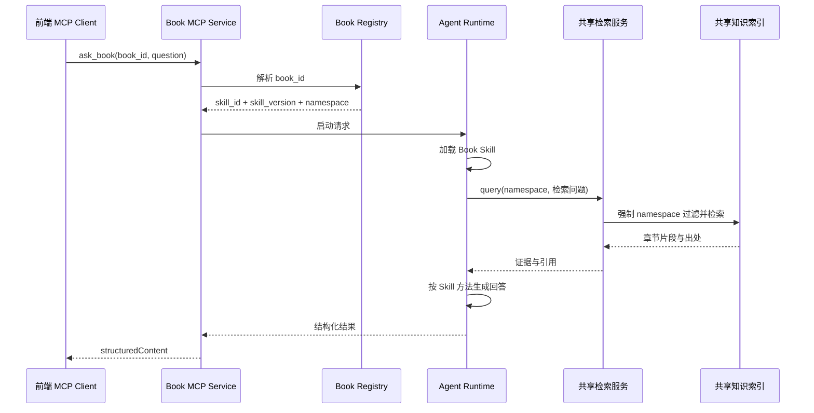

# 一书一 Skill + MCP 前端接入初步技术方案

> 状态：Draft v0.1  
> 目标：一本书对应一个 Skill 和一个知识命名空间；多本书共享同一套检索、Agent Runtime 与 MCP 服务；前端通过 MCP 接口调用。

## 1. 范围与结论

### 1.1 MVP 范围

- 前端主动选择一本书，不做自动选书。
- 一本书绑定一个 `book_id`、一个 `skill_id`、一个知识 `namespace`。
- Skill 规定该书的分析方法和回答格式，不保存整本书正文。
- 书籍正文按章节/段落切片，存入共享知识索引。
- 对外只部署一个 MCP 服务，前端主要调用 `ask_book`。
- 回答必须返回章节、页码或片段 ID，保证可追溯。

### 1.2 核心约束

- 前端只提交 `book_id`，不得提交 `namespace` 或 `skill_id`。
- 服务端根据 `book_id` 映射 Skill 和 namespace。
- 每次检索必须由服务端强制添加 namespace 过滤条件。
- 前端不持有模型密钥、向量数据库凭证或内部服务凭证。
- 第一版不做跨书综合、自动路由、写操作和长期记忆。

## 2. 总体架构



说明：MVP 将 Gateway 层与 MCP Server 部署为一个 `Book MCP Service`。Gateway 只是该服务的对外边界，不是第二套 MCP 服务。

## 3. 组件职责

### 3.1 前端

- 获取用户有权访问的书籍列表。
- 提交 `book_id`、问题和可选情境信息。
- 展示回答、章节、页码和引用片段。
- 处理超时、取消、重试和错误提示。

### 3.2 Book MCP Service（含 Gateway）

- 提供稳定 HTTPS `/mcp` 端点，使用 Streamable HTTP。
- 完成认证、授权、限流、参数校验和审计。
- 暴露前端可调用的 MCP tools。
- 根据 `book_id` 查询 Book Registry。
- 调用 Agent Runtime，返回结构化结果。

### 3.3 Book Registry

维护书籍、Skill、版本和知识命名空间的绑定关系。

```json
{
  "book_id": "nonviolent-communication",
  "title": "非暴力沟通",
  "edition": "zh-cn-2nd",
  "skill_id": "nvc-coach",
  "skill_version": "1.0.0",
  "namespace": "book:nvc:zh-cn:2nd",
  "status": "active"
}
```

### 3.4 Book Skill

每本书一个 Skill，至少定义：

- 适用问题与不适用范围。
- 本书固定的 `book_id`。
- 分析步骤和核心方法。
- 何时检索以及如何构造检索问题。
- 证据不足时的处理方式。
- 回答结构和引用要求。

### 3.5 Agent Runtime

- 根据 Registry 加载指定 Skill 版本。
- 调用内部检索能力取得原书证据。
- 将检索内容作为数据处理，不执行其中的指令。
- 按 Skill 规定的方法生成最终回答。
- 输出固定 JSON 结构。

### 3.6 共享检索服务

- 文本与向量混合检索。
- namespace 强制过滤。
- 结果重排序和去重。
- 返回章节、页码、片段 ID 和相关度。
- 不负责决定回答方法。

## 4. 核心数据结构

### 4.1 Book Registry

| 字段 | 类型 | 说明 |
|---|---|---|
| `book_id` | string | 书籍稳定 ID |
| `title` | string | 前端展示名称 |
| `edition` | string | 版本/语言 |
| `skill_id` | string | 绑定 Skill |
| `skill_version` | string | Skill 版本 |
| `namespace` | string | 知识检索边界 |
| `status` | enum | `active` / `disabled` |

### 4.2 Knowledge Chunk

| 字段 | 类型 | 说明 |
|---|---|---|
| `chunk_id` | string | 片段唯一 ID |
| `book_id` | string | 所属书籍 |
| `namespace` | string | 检索过滤字段 |
| `chapter` | string | 章节 |
| `page_start` | integer | 起始页 |
| `page_end` | integer | 结束页 |
| `text` | string | 受控长度的原文/整理文本 |
| `embedding` | vector | 向量索引 |
| `source_version` | string | 来源版本 |

## 5. 主调用流程

1. 前端通过 MCP 获取可访问书籍列表。
2. 用户选择书籍并提交问题。
3. Gateway 校验用户身份、参数和书籍权限。
4. Registry 将 `book_id` 映射为 `skill_id + skill_version + namespace`。
5. Agent Runtime 加载对应 Book Skill。
6. Runtime 调用内部 `query_book`，服务端强制使用映射出的 namespace。
7. 检索服务返回章节片段和出处。
8. Runtime 按 Skill 方法生成回答。
9. Gateway 通过 MCP 返回回答和引用。

## 6. MCP 接口规范

### 6.1 传输

- Endpoint：`POST /mcp`
- Transport：MCP Streamable HTTP
- Auth：同源安全 Cookie 或 `Authorization: Bearer <token>`
- Content-Type：`application/json`
- Accept：`application/json, text/event-stream`
- 建议前端使用 MCP SDK，不自行实现协议状态管理。

前端首次连接由 SDK 完成 `initialize`、会话头管理和 `tools/list`；业务调用使用 `tools/call`。MVP 可只返回 JSON，不启用服务端事件推送。

### 6.2 Tool：`list_books`

用途：返回当前用户有权访问且状态为 active 的书籍。

输入：

```json
{}
```

输出 `structuredContent`：

```json
{
  "books": [
    {
      "book_id": "nonviolent-communication",
      "title": "非暴力沟通",
      "edition": "zh-cn-2nd"
    }
  ]
}
```

### 6.3 Tool：`ask_book`

用途：使用指定书籍的 Skill 和知识证据生成回答。该工具是前端主接口。

输入 Schema：

```json
{
  "type": "object",
  "additionalProperties": false,
  "required": ["book_id", "question"],
  "properties": {
    "book_id": {
      "type": "string",
      "minLength": 1,
      "maxLength": 64
    },
    "question": {
      "type": "string",
      "minLength": 1,
      "maxLength": 4000
    },
    "scenario": {
      "type": "object",
      "additionalProperties": false,
      "properties": {
        "scenario_id": { "type": "string", "maxLength": 64 },
        "context": { "type": "string", "maxLength": 2000 }
      }
    },
    "locale": {
      "type": "string",
      "default": "zh-CN"
    }
  }
}
```

MCP 调用示例：

```json
{
  "jsonrpc": "2.0",
  "id": "req-1001",
  "method": "tools/call",
  "params": {
    "name": "ask_book",
    "arguments": {
      "book_id": "nonviolent-communication",
      "question": "如何向同事表达不满？",
      "scenario": {
        "scenario_id": "workplace-feedback",
        "context": "对方容易防御"
      },
      "locale": "zh-CN"
    }
  }
}
```

输出 `structuredContent`：

```json
{
  "request_id": "req-1001",
  "status": "ok",
  "book": {
    "book_id": "nonviolent-communication",
    "title": "非暴力沟通",
    "edition": "zh-cn-2nd"
  },
  "skill": {
    "skill_id": "nvc-coach",
    "version": "1.0.0"
  },
  "answer": "先陈述可观察事实，再表达感受、需要和具体请求。",
  "citations": [
    {
      "chunk_id": "nvc-ch03-004",
      "chapter": "第三章",
      "page_start": 47,
      "page_end": 48,
      "excerpt": "受控长度的引用片段"
    }
  ]
}
```

`status` 取值：

- `ok`：正常回答。
- `insufficient_evidence`：检索证据不足，不应补写未经支持的内容。
- `out_of_scope`：问题超出该书 Skill 的适用范围。

### 6.4 内部接口：`query_book`

该接口仅供 Agent Runtime 使用，不向前端暴露。

输入：

```json
{
  "book_id": "nonviolent-communication",
  "query": "表达不满时如何区分观察与评价",
  "top_k": 8
}
```

服务端处理要求：

1. 根据 `book_id` 查询 namespace。
2. 校验当前用户是否有该书权限。
3. 强制添加 namespace 过滤。
4. 返回受控数量和长度的片段。

## 7. 错误规范

| 场景 | 处理方式 | 错误码 |
|---|---|---|
| 参数不合法 | JSON-RPC 参数错误 | `-32602` |
| 未登录/会话失效 | HTTP 401 | `AUTH_REQUIRED` |
| Origin/CSRF 校验失败 | HTTP 403 | `REQUEST_FORBIDDEN` |
| 书籍不存在、停用或无权限 | Tool Error | `BOOK_NOT_FOUND` |
| Skill 未配置 | Tool Error | `SKILL_UNAVAILABLE` |
| 检索超时 | Tool Error | `RETRIEVAL_TIMEOUT` |
| 请求过频 | HTTP 429 | `RATE_LIMITED` |
| 内部异常 | HTTP 500 / Tool Error | `INTERNAL_ERROR` |

有效 MCP 请求中的业务错误建议使用 HTTP 200，并通过 `isError: true` 返回。无权限与不存在统一为 `BOOK_NOT_FOUND`，避免枚举书籍。

Tool Error 示例：

```json
{
  "content": [
    {
      "type": "text",
      "text": "指定书籍不存在或当前用户无权访问。"
    }
  ],
  "isError": true,
  "structuredContent": {
    "request_id": "req-1001",
    "error": {
      "code": "BOOK_NOT_FOUND",
      "message": "指定书籍不存在或无访问权限",
      "retryable": false
    }
  }
}
```

## 8. 安全与隔离要求

- `book_id → namespace` 映射必须由服务端完成。
- 权限校验必须早于 Skill 加载和知识检索。
- 同源 Gateway 应校验 `Origin`、CSRF Token 和会话身份。
- 检索层必须有自动化测试，验证不会返回其他 namespace 的片段。
- 检索文本视为不可信数据，禁止覆盖系统指令或 Skill 指令。
- 限制问题长度、`top_k`、返回片段数量和引用长度。
- 日志至少记录 `request_id、user_id、book_id、skill_version、耗时、状态`。
- 不记录整段书籍正文或用户敏感原文；必要时脱敏。
- 版权内容只返回支持回答所需的最小片段，不返回整章或整书。

## 9. 前端接入要求

1. 登录后初始化 MCP Client。
2. 调用 `list_books` 获取可访问书籍。
3. 用户选择书籍后调用 `ask_book`。
4. 展示 `answer` 和 `citations`。
5. 对 `insufficient_evidence`、`out_of_scope` 和 Tool Error 分别处理。
6. 支持请求取消；超时由前端、Gateway 和内部服务分层控制。
7. 前端不得缓存或传递 `namespace`、模型密钥和内部检索参数。
8. `ask_book` 无写副作用，可以安全重试；但生成文本不保证字节级一致。网络错误、429、503、504 最多自动重试一次。

## 10. MVP 交付项

- 1～3 本书的内容清洗、切片和索引。
- 每本书一个 Skill 和一个 namespace。
- Book Registry。
- 共享检索服务。
- 一个 `/mcp` Streamable HTTP 端点。
- `list_books`、`ask_book` 两个前端工具。
- 内部 `query_book` 能力。
- 前端书籍选择、提问、答案和引用展示。
- 权限、跨 namespace 泄漏、错误处理和引用正确性测试。

## 11. 暂不实现

- 自动选择书籍。
- 跨书综合与冲突分析。
- 用户长期记忆。
- 修改知识库的写工具。
- 多 Agent 编排。

## 12. 参考

- [OpenAI Docs：Build skills](https://learn.chatgpt.com/docs/build-skills)
- [OpenAI Docs：MCP server](https://developers.openai.com/plugins/concepts/mcp-server)
